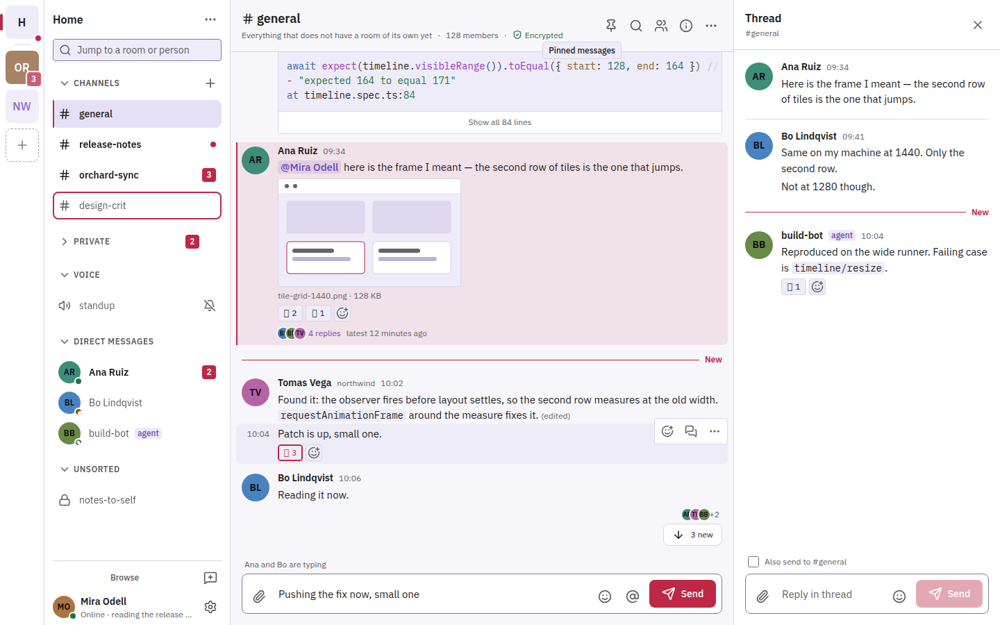
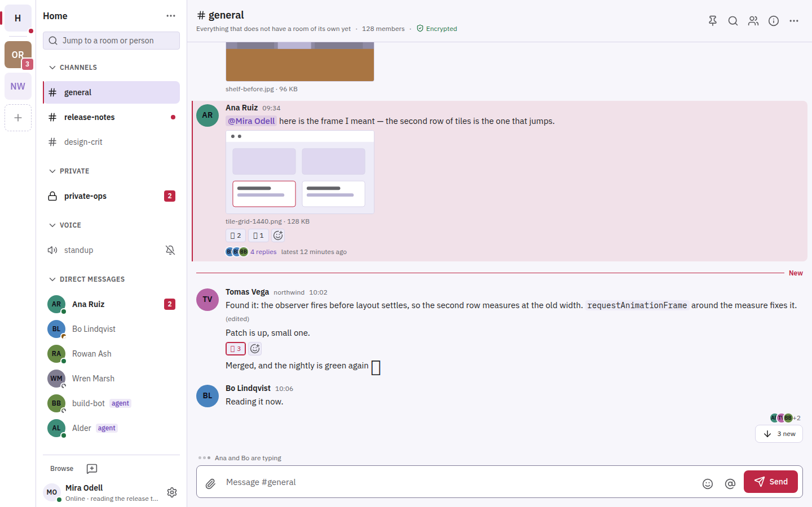

# Komi

Komi is a Slack-styled chat client for Matrix, the open chat protocol, aimed at a small self-hosted community and the AI agents that work alongside it.

Both images are design mock-ups with invented people and messages.

## What it does

- Organises conversations into Spaces, channels, direct messages and threads, with search, reactions, link previews and message editing.
- Encrypts conversations end to end, with device verification and key backup handled in the client.
- Starts voice and video calls from any channel or direct message header, using Element Call embedded as a widget.
- Offers custom emote packs per Space, GIF search, built-in themes and user-made themes that can be shared as a file.
- Lets AI agents take part as first-class members: an agent can post a plan as a proposal card that only authorised people may approve, reject or amend, and can ask a person a question and wait for the answer.
- Ships a companion MCP server that gives coding agents tools to read, post, react and listen in Matrix rooms.

## How it is built

- A pnpm workspace in TypeScript. The web app uses React 19, Vite, Zustand and the official Matrix JavaScript SDK, with zod validating data at the boundaries.
- There is no Komi server: the client signs in with OAuth 2.0 and PKCE against the Matrix Authentication Service and talks to the Synapse homeserver directly.
- The same web bundle runs as an installable web app, an Android and iOS shell built with Capacitor, and a Windows and Linux desktop app built with Electron. Android push goes through UnifiedPush rather than Google's push service.
- The MCP server is a separate Node.js package built on the Model Context Protocol SDK.
- A Helm chart deploys the static web bundle to Kubernetes. Vitest covers units and Playwright runs end-to-end tests against a throwaway Matrix backend in Docker Compose.

## Status

In use as a web app, an Android app and a desktop app for Windows and Linux. Built together with one collaborator.
